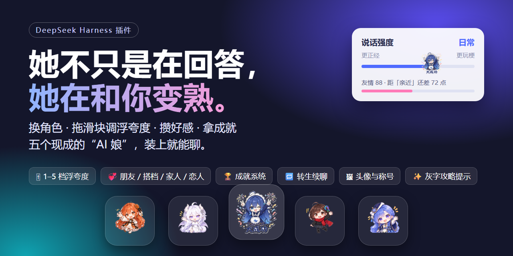

# dsh-persona-kit
<p align="center"></p>

**让 DeepSeek Harness 里的 AI 变成一个有脾气、会记得你、越聊越熟的“人”。**
换角色、拖滑块调她的浮夸程度、攒好感、拿成就、给她和你加头像——一个插件全包。

*English: turns the assistant in DeepSeek Harness into someone with a voice, a memory of you and a bond that grows — roles, a 1–5 playfulness slider, stickers, relationships, achievements, avatars. [Jump to English](#english).*

---

## 你会得到什么

- **五个现成的角色，装上就能聊。** 软糯犯懒的鲸鱼娘（DeepSeek）、知书达理的大小姐 Claude、热心有点呆的豆包、古老又周全的银龙姐姐 ChatGPT、会安排事情的富商千金千问。之后还会加 Grok、Gemini……
- **一根滑块管她的“浮夸度”。** 1 档像靠谱同事，5 档满屏玩梗、每句都带表情包。滑块的旋钮就是她的头像，切到谁就是谁。
- **关系会长大，而且各算各的。** 朋友、搭档、家人（女儿 / 妹妹 / 姐姐 / 妈妈，严格亲情）、恋人（温柔、不露骨、不预设任何人的性别）。每种关系有自己的称号和成长方式，同一个角色换一种关系，就是一段新的故事。
- **聊着聊着有成就。** 40 枚徽章分 7 个系列：通用的、角色专属的、她说出某句口头禅触发的，都在里面；面板顶上记着累计天数、当前连续和最长连续，4 枚隐藏徽章在拿到之前，连条件都还留在插件那边。全部由插件按真实对话统计，AI 自己说“解锁了”不算数。
- **上下文快满了可以“转生”。** 她写好交接说明，在新会话里接着聊，好感和称号都带过去。
- **头像、名字、关系写在每条回复上面。** 大小、位置、显示什么都能改；还能把左下角账号换成你自己的名字和头像。
- **输入框里的灰字提示。** 要么猜你下一句，要么给你一句“能拉近距离”的话（攻略模式，写得像小说台词，不是说明书）。Tab 采纳。默认关闭。
- **中文优先，也有英文。**

## 三步上手

```bash
# 1. 装进 DeepSeek Harness（需要 0.2.1-rc.x 与 Node ≥ 22.13）
node ~/.dsh/skills/plugin-manager/dsh-plugin.cjs install link:/你的路径/dsh-persona-kit

# 2. 把现成角色和她们的表情包拷进你的 ~/.dsh（不会覆盖已有的）
node tools/install-examples.mjs --presets

# 3. 在 ~/.dsh/persona-kit/config.json 里打开切换器，重启
#    { "roles": { "enabled": true, "defaultRole": "whale" } }
```

重启后在对话里输入 `/role claude-chat`，点输入框右边的小人调浑度。其余设置（关系、头像、灰字模式）都在点开小人后的菜单里。

> 角色是 `~/.dsh/roles/<id>/` 里的一个文件夹：`ROLE.md` 写她是谁，`card.json` 写五档话术、成就和头像。想做自己的角色，抄一个预设改就行。详见 [使用手册](docs/MANUAL.md)。

## 关于预设角色

`presets/roles/` 里的五个角色是社区里流传的“AI 娘”形象的同人二次创作，人设文字和旋钮小图由作者与 AI 协作整理、绘制。**它们与 DeepSeek、Anthropic、OpenAI、字节、阿里等公司没有任何关系**，只是爱好者的玩笑。每个角色配一套自己的表情包（24 张；鲸鱼娘 100 张），由 AI 绘图工具按角色形象生成，同样是同人作品。示例用的 12 张小脸是原创的。如果你是相关形象的作者并希望下架，请开 issue。

## 隐私与花费

- 除了 DeepSeek Harness 本来就会发的模型请求，什么都不出本机。
- 灰字提示每条回复后多调用一次模型，发送最近 6 条消息（`sk-…`、令牌等先打码）。所以默认关闭，并且可以指定一个便宜的模型。
- 插件的接口只认本机请求，代理转发、别的网站发来的一律拒绝。

## 更多

- 📖 [使用手册](docs/MANUAL.md)：全部功能、配置项、角色卡格式、表情包格式、已知限制
- 🤝 [贡献名单](CONTRIBUTORS.md)：人，**以及写了这个插件的 AI 们**
- 📜 [第三方说明](THIRD_PARTY_NOTICES.md) · [更新记录](CHANGELOG.md) · MIT 协议

---

## English

**Turn the assistant in DeepSeek Harness into someone with a voice, a memory of you and a bond that grows.**

- **Five ready-made roles** (Chinese-language personas; Grok and Gemini are planned) plus an English example role.
- **A 1–5 slider** from "reliable colleague" to "full running-joke mode with a sticker in every reply"; the knob is the role's own picture.
- **Relationships that grow per role and per kind** — friend, partner, family (strictly familial), lover (gentle, non-explicit, no assumptions about anyone's gender).
- **Achievements, rebirth** into a fresh session when the context fills up, **avatars** above each reply, optional **grey suggestions** in the input box.
- The interface is Chinese by default; set `"language": "en"` in `~/.dsh/persona-kit/config.json` for English.

Install: `node ~/.dsh/skills/plugin-manager/dsh-plugin.cjs install link:/path/to/dsh-persona-kit`, then `node tools/install-examples.mjs --presets`. Full reference: [docs/MANUAL.md](docs/MANUAL.md).

The preset roles are fan-made takes on community "AI girl" characters and are not affiliated with any company.
